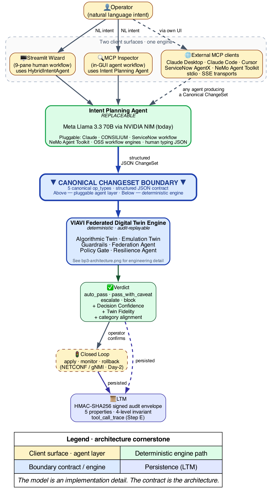
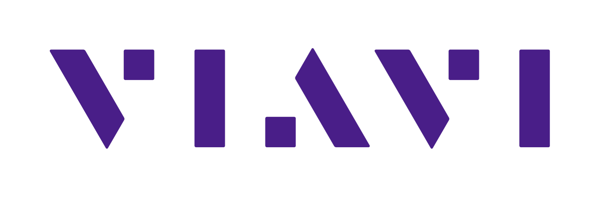

<!--
SPDX-FileCopyrightText: Copyright (c) 2026, VIAVI Solutions Inc. All rights reserved.
SPDX-License-Identifier: Apache-2.0
-->

# VIAVI Closed-Loop Intent Assurance

**A Federated Digital Twin Blueprint for IP Network Change Validation**

A joint VIAVI × NVIDIA blueprint timed to **DTW Ignite 2026** (Copenhagen, June 23-25 · [Booth 236](https://tmforum.org/events/dtw)). Companion to the [VIAVI IP Transport blog](https://blogs.viavisolutions.com/) and to the VIAVI [RAN Energy Efficiency blueprint](https://github.com/VIAVI-CTOO/es-blueprint-rsg).

> *Twins predict what will happen. Governance decides whether it is allowed.*



## Table of Contents

- [Overview](#overview)
- [Problem Statement](#problem-statement)
- [System Architecture](#system-architecture)
- [Agent Architecture](#agent-architecture)
- [Closed-Loop Execution Flow](#closed-loop-execution-flow)
- [Repository Structure](#repository-structure)
- [Requirements](#requirements)
- [Setup Instructions](#setup-instructions)
- [Running the Notebook](#running-the-notebook)
- [Operator Intent Input](#operator-intent-input)
- [Output](#output)
- [Collaborating with VIAVI](#collaborating-with-viavi)
- [Troubleshooting](#troubleshooting)
- [Purpose](#purpose)
- [Contributors](#contributors)
- [Disclaimer](#disclaimer)
- [License](#license)

## Overview

The **Closed-Loop Intent Assurance** blueprint provides a simulation-validated framework for evaluating AI-driven network-change decisions in **IP Transport networks**. It is the IP-transport companion to VIAVI's RAN Digital Twin work.

This blueprint integrates:

- VIAVI **Algorithmic Twin** — deterministic, vendor-neutral prediction of post-change network state (SPF · BGP · MPLS-TE · SR-TE · services · utilization)
- VIAVI **Emulation Twin** — independent observation via Nokia SR Linux containerlab + VIAVI TestCenter Virtual
- VIAVI **Federation Agent** — three-layer hybrid reconciliation (deterministic rules ~70% · severity-weighted math ~20% · Nemotron arbitration ~10%)
- VIAVI **Policy Gate** — YAML-driven deterministic verdict aligned to EU AI Act / TMF / ETSI / NIST
- **NVIDIA NIM** — hosted inference for Meta Llama 3.3 70B (Intent Planning Agent) + Nemotron Nano-9B-v2 (Federation Layer-3 arbitration)
- **NVIDIA NeMo Agent Toolkit (NAT)** — agentic workflow orchestration
- **Model Context Protocol (MCP)** — vendor-neutral integration surface (Claude · ChatGPT · Gemini · custom copilots can drive the blueprint)

The system simulates the network's response to a proposed change, scores the result against governance policy, and emits an audit-replayable verdict before the change touches the live network.

## Problem Statement

Operating an IP transport network has long meant making changes, watching what happens, and reacting. With millisecond SLA commitments, the connective tissue of premium services, and blast radius that can span multiple geographies, that posture is no longer viable.

Aggressive change techniques (route withdrawals, SR-TE metric drains, link maintenance) can cascade into service-impacting outcomes if applied without validation.

This blueprint evaluates change proposals in a validated digital-twin loop to ensure:

- **Predicted impact** is computed before any packet moves
- **Per-service SLA exposure** is checked against policy
- **Blast radius** is bounded
- **Governance gates** apply EU AI Act / TMF / ETSI / NIST controls
- **Verdicts are audit-replayable** — same inputs always produce the same HMAC-SHA256 signed envelope

## System Architecture


The architecture is built on a single contract — the **Canonical ChangeSet Boundary**:

```
Operator intent (natural language)
        │
        ▼
┌──────────────────────────────────────┐
│     Intent Planning Agent            │   ← REPLACEABLE
│  (Meta Llama 3.3 70B via NVIDIA NIM  │
│   today; tomorrow Claude, CONSILIUM, │
│   ServiceNow, NeMo, or a human       │
│   typing structured JSON)            │
└──────────────────────────────────────┘
        │
═══════════ Canonical ChangeSet ═══════════
        │
        ▼
┌──────────────────────────────────────┐
│     Federated Digital Twin Engine    │   ← deterministic · audit-replayable
│   Algorithmic Twin · Emulation Twin  │
│   Guardrails · Federation · Policy   │
└──────────────────────────────────────┘
        │
        ▼
✅ Verdict — auto_pass · pass_with_caveat · escalate · block
```

**The model is an implementation detail. The Canonical ChangeSet contract is the architecture.**

## Agent Architecture

| # | Agent / Engine | What it does | Backend (today) |
|---|---|---|---|
| 1 | **IntentPreprocessor** | Tier-0 deterministic preprocessor — out-of-domain verb filter, slot-source provenance, snapshot pattern extraction. Catches ~30% of edge cases at zero LLM cost. | Pure Python |
| 2 | **Intent Planning Agent** | Translates NL operator intent into a structured Canonical ChangeSet (one of 5 canonical op types). | Meta Llama 3.3 70B via NVIDIA NIM |
| 3 | **Algorithmic Twin** | 5 deterministic engines — SPF · BGP · MPLS-TE · services · utilization. Per-service OWD + util envelopes. | networkx + custom (VIAVI engine) |
| 4 | **Emulation Twin** | Independent observation of the post-Δ state via real protocol stacks. | Nokia SR Linux containerlab + VIAVI TestCenter Virtual |
| 5 | **Guardrails** | Blast radius + risk score + severity-tagged findings. Vendor-neutral structured output. | Deterministic Python |
| 6 | **Federation Agent** | Three-layer hybrid reconciliation: ~70% rules · ~20% math · ~10% Nemotron arbitration. | Pure Python + NVIDIA NIM Nemotron Nano-9B-v2 (rare) |
| 7 | **Policy Gate** | YAML-driven deterministic verdict. Computes Decision Confidence + Operational Risk + Policy Compliance. | YAML rules |
| 8 | **Resilience Agent** | Pre-mortem reasoning on escalate / block verdicts before final dispatch. | NVIDIA NIM Llama 70B |

LLMs **propose**; deterministic engines **validate**; policy **decides**; the operator **approves**. Every step is captured in an HMAC-SHA256 signed audit envelope.

## Closed-Loop Execution Flow

1. **Operator types intent** in plain English (Streamlit Wizard) — or sends a Canonical ChangeSet via MCP (Claude / ChatGPT / Gemini / in-house copilot)
2. **Intent Planning Agent** decomposes the intent into a Canonical ChangeSet
3. **Algorithmic Twin** computes the predicted post-Δ network state
4. **Emulation Twin** observes the post-Δ behavior on real protocol stacks
5. **Guardrails** compute blast radius + risk
6. **Federation Agent** reconciles the two twins → Twin Fidelity score + Decision Confidence
7. **Policy Gate** issues the verdict
8. **(On escalate / block)** Resilience Agent runs a pre-mortem
9. **Operator confirms** → dispatch via gNMI / NETCONF
10. **60-second post-deployment KPI monitoring** against SLA targets. Automatic rollback on breach.
11. **LTM persists the HMAC-SHA256 signed audit envelope**

## Repository Structure

This public repository contains the orchestration layer and architecture documentation. The underlying federated digital twin engine is available via VIAVI partnership and is not included in this repository.

```
closed-loop-intent-assurance/
├── README.md                    ← you are here
├── LICENSE                      ← Apache-2.0
├── requirements.txt             ← Jupyter + NVIDIA NIM client libs
├── setup.sh · run.sh            ← environment setup + notebook launcher
├── .env.example                 ← required env vars (NVIDIA_API_KEY)
├── configs/
│   └── config_example.yml       ← sample blueprint configuration
├── notebooks/
│   └── closed_loop_intent_assurance_demo.ipynb
│                                ← walks through Intent Planning Agent →
│                                  Canonical ChangeSet → engine verdict shape
├── data/
│   └── viavi-snapshot-6router.json   ← canonical synthetic 6-router topology
└── image/
    ├── architecture-cornerstone.{png,svg}   ← cornerstone diagram (above)
    └── architecture-pipeline.{png,svg}       ← engineering pipeline diagram
```

## Requirements

- **Python 3.10 – 3.13**
- **NVIDIA API key** — sign up at [build.nvidia.com](https://build.nvidia.com) (free for development)
- **VIAVI Federated Digital Twin engine** — available via VIAVI partnership ([contact below](#collaborating-with-viavi))
- **macOS or Linux**

## Setup Instructions

```bash
# 1. Clone
git clone https://github.com/VIAVI-AIOPS/closed-loop-intent-assurance.git
cd closed-loop-intent-assurance

# 2. Set up the environment file
cp .env.example .env
# Edit .env and set NVIDIA_API_KEY=nvapi-...

# 3. Install dependencies (~2-3 minutes)
./setup.sh
```

## Running the Notebook

```bash
./run.sh
# Opens the notebook in your browser
```

The notebook demonstrates:

- How the **Intent Planning Agent** calls NVIDIA NIM (Meta Llama 3.3 70B) to translate an operator's plain-English request into a structured **Canonical ChangeSet**
- The exact **JSON shape** of the ChangeSet that any external agent (Claude / ChatGPT / Gemini / in-house copilot) would produce
- The **MCP tool surface** that an external agent calls to drive the engine
- The **verdict envelope** shape returned by the engine — Twin Fidelity score, Decision Confidence band, per-category alignment, blast radius

The actual engine computations are produced by VIAVI's Federated Digital Twin engine; the public notebook uses sample engine responses for the canonical demo intents. For the live, end-to-end demo, see the booth at DTW Ignite 2026 (June 23-25, Copenhagen, Booth 236) or [contact VIAVI](#collaborating-with-viavi).

## Operator Intent Input

The blueprint accepts plain-English operator change requests. Examples:

| Intent | What the Intent Planning Agent produces |
|---|---|
| *"Withdraw a /20 aggregate from the Toronto core"* | `withdraw_originated_route` on router `YYZ-CORE-3`, prefix `111.46.176.0/20` |
| *"Take a backbone link down for maintenance"* | `down_link` between `YVR-CORE-1` ↔ `YYC-CORE-2`, with maintenance-window ISO timestamp |
| *"Drain traffic via ISIS metric change"* | `metric_change` on link `L2`, new metric `9999` |
| *"Set the ISIS metric on L4 to 9999 during the approved Saturday 02:00-04:00 UTC maintenance window"* | Single-op `metric_change` with ISO-8601 maintenance_window |

The 5 canonical op types: `withdraw_originated_route` · `withdraw_export_policy` · `down_link` · `down_node` · `metric_change`. Multi-op ChangeSets are also supported.

## Output

Every closed-loop run produces a structured audit envelope:

```json
{
  "change_id": "DEMO-MAINTENANCE-WINDOW",
  "verdict": "pass_with_caveat",
  "base_tier": "auto_pass",
  "final_tier": "pass_with_caveat",
  "twin_fidelity_score": 0.98,
  "decision_confidence_score": 0.81,
  "decision_confidence_band": "HIGH",
  "operational_risk_band": "LOW",
  "category_alignment": {
    "rib": 1.0, "path": 1.0, "owd": 0.95, "util": 0.92, "convergence": 1.0
  },
  "blast_radius": {
    "affected_routers": ["YVR-CORE-1", "YYC-CORE-2", "YVR-RR-11"],
    "affected_links": [["YVR-CORE-1", "YYC-CORE-2"]],
    "affected_service_ids": ["SVC-001", "SVC-003"],
    "affected_revenue_usd_per_mo": 185000
  },
  "caveats": ["maintenance_window_within_approved_registry"],
  "envelope_hash": "<HMAC-SHA256>"
}
```

The `envelope_hash` is replay-deterministic — running the same intent against the same snapshot always produces the same envelope. That's the audit-replay guarantee.

## Collaborating with VIAVI

Organizations looking to extend this blueprint or develop their own agentic network-automation solutions can collaborate with **VIAVI** by leveraging:

- **VIAVI's Federated Digital Twin engine** — the Algorithmic + Emulation twin engines that produce the predictions in this blueprint
- **VIAVI NITRO AIOps** — policy gate, governance, and audit framework
- **VIAVI TestCenter Virtual** — emulation twin observation layer

Together, they allow partners to build closed-loop, agentic workflows in which LLM-based planners and validators can reason over network state, apply actions, and immediately observe their impact in a high-fidelity twin before any change touches a live network.

**Contact:** open a GitHub issue, or reach out via [VIAVI Solutions](https://www.viavisolutions.com/en-us/contact-us).

## Troubleshooting

| Symptom | Likely cause | Fix |
|---|---|---|
| `setup.sh` fails on dependency install | Python version mismatch | Use Python 3.10 – 3.13 |
| Notebook says "NVIDIA_API_KEY missing" | `.env` file not populated | Get a key at [build.nvidia.com](https://build.nvidia.com); set `NVIDIA_API_KEY=nvapi-...` in `.env` |
| LLM sanity check fails | Invalid API key or NIM endpoint unreachable | Verify the key at [build.nvidia.com/settings/api-keys](https://build.nvidia.com/settings/api-keys); check your network proxy |
| Engine verdicts in notebook are sample-only | Engine is provided via VIAVI partnership | Contact VIAVI for live access — see [Collaborating with VIAVI](#collaborating-with-viavi) |

## Purpose

This blueprint demonstrates how a **federated digital twin**, paired with **NVIDIA accelerated AI**, can deliver pre-deployment validation for IP transport changes at the speed transport automation demands. It is the IP-transport companion to VIAVI's RAN Digital Twin work — together they form an integrated portfolio across the two major operational domains.

## Contributors

[](https://www.viavisolutions.com)

Manish Shrivastava ([@manishkshrivastava](https://github.com/manishkshrivastava)) · Richard Wong ([@RichFree](https://github.com/RichFree)) · Fabian Toh ([@fabiantoh-viavi](https://github.com/fabiantoh-viavi)) · Chrish Chapman

[](https://www.nvidia.com)

Ari Uskudar ([@auskudar](https://github.com/auskudar))

## Disclaimer

> This Closed-Loop Intent Assurance blueprint is intended for **Proof-of-Concept and research use only**. It is not designed for production deployment. Use in production environments is at the user's own risk. The authors and contributors accept no liability for operational impacts or damages.
>
> The orchestration layer + architecture documentation are open-sourced under Apache-2.0; the underlying VIAVI Federated Digital Twin engine is available via VIAVI partnership and is not included in this public repository.

## License

Apache-2.0 — see [`LICENSE`](LICENSE).

Notebook calls the [NVIDIA AI Foundation Models Community License](https://docs.nvidia.com/ai-foundation-models-community-license.pdf) for the LLMs hosted via NIM.

## See Also

- [VIAVI Solutions](https://www.viavisolutions.com)
- [NVIDIA Build](https://build.nvidia.com) — NIM hosted inference + API keys
- [DTW Ignite 2026](https://tmforum.org/events/dtw) — Copenhagen, June 23-25 · VIAVI Booth 236
- [VIAVI RAN Energy Efficiency blueprint](https://github.com/VIAVI-CTOO/es-blueprint-rsg) — companion RAN blueprint

---

*VIAVI and NVIDIA on the road to autonomous networks — Integrating Transport Network Digital Twins*
This is my first github practice update.